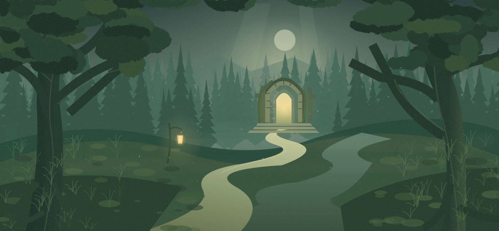

# Lisière — RPG narratif avec un maître du jeu IA

Lisière est un prototype de jeu solo dans le navigateur : vous incarnez Aëlin, un rôdeur dont les rencontres, la quête et les choix sont écrits en direct par Codex. Le moteur JavaScript fixe les règles et résout les actions ; l’IA raconte leurs conséquences et propose la suite.

Le projet explore une question concrète : **comment faire évoluer une histoire générée tout en gardant des ressources, des conséquences et une progression contrôlées par du code ?** Il s’adresse aux amateurs de jeux narratifs et aux développeurs qui souhaitent examiner une intégration d’IA générative dans un jeu.

**Maturité : prototype local.** Il nécessite Node.js et votre propre connexion à Codex CLI. Il ne propose ni compte joueur, ni serveur multijoueur, ni démonstration hébergée. Chaque scène utilise le quota du compte Codex connecté ; la durée et la qualité de la génération varient.



*Illustration intégrée au jeu, et non capture d’une partie.*

## Ce qui fonctionne

- Une quête et des scènes générées à la demande, avec trois choix par scène non terminale.
- Coûts, probabilités, vitalité, instinct, or et inventaire gérés par le moteur. Une option gratuite et garantie permet toujours de progresser.
- Conclusion après cinq points de progression, puis nouvelle quête avec le même personnage ; épilogue en cas de mort.
- Mémoire narrative cumulative, journal des dernières décisions et carte de cinq régions prédéfinies.
- Sauvegarde dans le navigateur, reprise des demandes en attente et erreurs explicites si le narrateur échoue.
- Commandes au clavier, interface adaptée aux petits écrans et ambiance synthétisée avec Web Audio.

Les régions, le personnage, les illustrations et l’interface sont prédéfinis. Les scènes jouées ne viennent pas d’un catalogue de textes. Les réponses simulées des tests restent dans les tests.

## Essayer en local

Prérequis : **Node.js 22 ou plus**, un navigateur récent et [Codex CLI](https://learn.chatgpt.com/docs/cli) installé et connecté à votre compte.

```sh
git clone https://github.com/Fares-Knight/Dummy-RPG.git
cd Dummy-RPG
codex login status
node server.mjs
```

Si Codex n’est pas connecté, exécutez `codex login` dans votre terminal habituel. Ouvrez ensuite **http://localhost:3000**. Une première scène est générée automatiquement, ou votre sauvegarde est reprise. Gardez la même adresse et le même port pour retrouver la sauvegarde de ce navigateur.

Aucune dépendance npm n’est nécessaire : pas d’installation de paquets ni de compilation pour lancer le jeu. `npm start` est un raccourci facultatif si npm est disponible. Le serveur est lié à `127.0.0.1` et n’est pas conçu pour être exposé sur Internet.

Choisissez avec les boutons ou les touches **1**, **2**, **3**. Une potion rend jusqu’à **7 points de vitalité**. Le bouton « Narrateur Codex » affiche le modèle annoncé, le temps de génération et la mémoire de l’histoire. En cas d’erreur, utilisez « Réessayer » pour reprendre la décision conservée.

### Configuration facultative

| Variable | Rôle | Valeur par défaut |
| --- | --- | --- |
| `PORT` | Port HTTP local | `3000` |
| `CODEX_BINARY` | Chemin de l’exécutable natif Codex | Recherche dans le `PATH`, installation npm Windows, puis extension VS Code OpenAI sous Windows |
| `CODEX_MODEL` | Modèle accessible au compte connecté | Modèle par défaut de Codex |

Ces variables sont lues dans l’environnement du processus. Le projet **ne charge pas automatiquement un fichier `.env`**. Exemple PowerShell pour changer de port :

```powershell
$env:PORT = '3001'
node server.mjs
```

L’application utilise l’authentification existante de Codex ; elle ne demande pas de clé API dans le navigateur et ne copie pas vos identifiants. Les données fictives de la partie sont transmises au narrateur. Les polices sont chargées depuis Google Fonts ; voir [les éléments tiers](docs/third-party.md).

## Choix techniques

**HTML, CSS et modules JavaScript natifs**, serveur HTTP Node.js, tests avec `node:test`, illustrations SVG et audio Web Audio. Aucune bibliothèque applicative à installer.

Le moteur résout l’action avant l’appel au modèle. Le narrateur reçoit ces faits, la scène actuelle, une mémoire cumulative et les six dernières étapes détaillées. Une réponse JSON doit respecter le schéma et les règles métier avant de remplacer la sauvegarde. Une réponse invalide autorise une seule nouvelle tentative de correction ; une panne ne produit pas de scène de secours.

Un identifiant stable permet de rejouer une requête sans appliquer deux fois son résultat tant qu’elle est dans le cache du serveur. Ce cache est limité aux 24 dernières requêtes réussies et disparaît au redémarrage : une nouvelle génération peut alors être nécessaire.

Cette séparation rend les règles testables sans accès au modèle. Elle ne garantit pas la cohérence littéraire de chaque réponse : les validations contrôlent les champs et les règles, pas toutes les contradictions possibles de l’histoire.

## Vérifier le projet

Tests automatiques des règles, sauvegardes, contrats du narrateur, routes HTTP et reprises de l’interface avec DOM simulé, **sans génération réelle ni quota Codex** :

```sh
node scripts/check.mjs
node --test tests/*.test.mjs
```

Le premier contrôle vérifie la syntaxe JavaScript. Le workflow [CI](.github/workflows/ci.yml) lance ces contrôles avec Node.js 22 et 24 sous Ubuntu et Windows, sans identifiants Codex.

Tests réels facultatifs, qui utilisent le compte Codex connecté :

```sh
node scripts/live-narrator.mjs
```

Ce script produit trois scènes, dont deux suites après décision. Pour vérifier deux générations via HTTP, démarrez le serveur dans un autre terminal puis exécutez :

```sh
node scripts/live-api.mjs
```

Une réponse à corriger peut occasionner un appel supplémentaire. Les traces sont enregistrées dans `.runtime/`, exclu de Git et non servi par HTTP. Les tests automatiques ne remplacent pas ces essais d’intégration au compte et à la version de Codex installés.

## Documentation et limites

- [Fonctionnement et règles de jeu](docs/fonctionnement.md)
- [Architecture, API, maintenance et dépannage](docs/architecture.md)
- [Limites et reste à faire priorisé](docs/roadmap.md)
- [Éléments tiers et droits](docs/third-party.md)
- [Vérifications de publication et leurs limites](docs/validation.md)

La sauvegarde est locale à un navigateur et une origine, sans synchronisation ni export intégré. La carte illustre les régions visitées ; elle ne permet pas de choisir une destination. La mémoire générée peut perdre des détails au fil d’une longue partie. Héberger le jeu demanderait une autre gestion de l’accès au narrateur et des quotas ; GitHub Pages seul ne peut pas exécuter ce serveur et Codex CLI.

## Licence

Le code du projet est publié sous [licence MIT](LICENSE). Les services et éléments tiers conservent leurs propres conditions, détaillées dans [la notice](docs/third-party.md).
