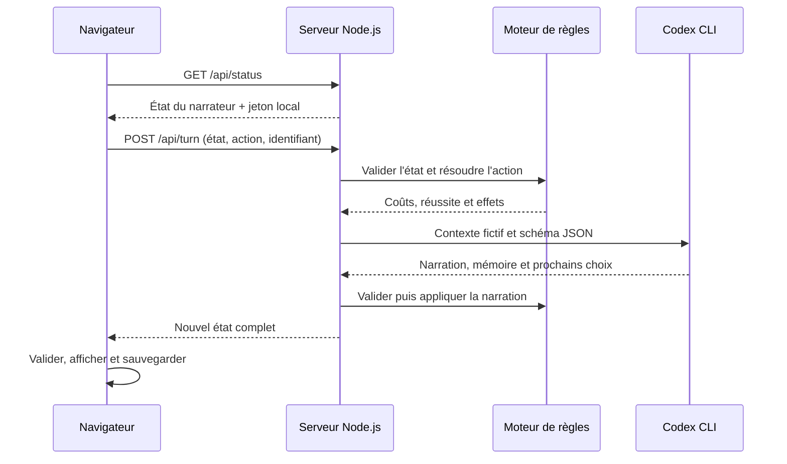

# Architecture et exploitation

Lisière est une application locale à un seul joueur. Le navigateur conserve la partie ; le serveur applique les règles et appelle un narrateur via Codex CLI. Il n’y a ni base de données, ni API d’administration, ni compte utilisateur applicatif.

## Composants et flux



| Fichier | Responsabilité |
| --- | --- |
| `server.mjs` | HTTP local, routes, validation des requêtes, cache de reprise et fichiers publics |
| `server/narrator.mjs` | Instructions narratives, schéma JSON, découverte de Codex, processus et validation de sa réponse |
| `src/engine.js` | Modèle de partie, règles chiffrées, validation et restauration |
| `src/app.js` | Rendu, commandes, localStorage, erreurs et reprises |
| `src/icons.js` | Icônes SVG intégrées |
| `index.html`, `styles.css`, `assets/` | Structure, présentation et illustrations |
| `tests/` | Tests Node.js et réponses fictives réservées à ces tests |
| `scripts/` | Essais avec le vrai narrateur et reconstruction du paysage |

Les modules sont servis directement. Aucun bundle, source map ou outil de build n’est requis.

## État d’une partie

La version du format est `2`. `newGame()` initialise la partie sans scène préécrite ; `restoreGame()` rejette les anciennes versions et les données ne respectant pas son contrat.

| Groupe | Champs principaux et rôle |
| --- | --- |
| Personnage | `hp`, `focus`, `gold`, `inventory` ; règles dans le moteur |
| Progression | `turn`, `questNumber`, `progress`, `status` (`playing`, `complete`, `dead`) |
| Monde | `region`, `visited` ; cinq identifiants autorisés |
| Narration | `scene`, `quest`, `memory`, `lastResult`, `journal` |
| Reproductibilité | `seed` du tirage pseudo-aléatoire ; une même sauvegarde et un même choix résolvent les mêmes effets |
| Génération | `generation` : fournisseur, modèle annoncé, durée, tentatives et identifiant de requête |

Le navigateur stocke l’état sous `lisiere.ai-adventure.v2` et la requête en attente sous `lisiere.ai-adventure.v2.pending`. Le journal garde au plus 100 décisions, la mémoire au plus 6 500 caractères, et le prompt transmet les six dernières décisions détaillées. Effacer le stockage du navigateur supprime la sauvegarde. L’état venant du client est validé mais pas signé : ce jeu local ne vise pas à empêcher un joueur de modifier sa propre partie.

## API locale

| Route | Entrée | Résultat |
| --- | --- | --- |
| `GET /api/status` | Aucune donnée de partie | `ready`, `provider`, `model`, `message`, `token` |
| `POST /api/turn` | JSON avec `requestId`, `action` et, selon l’action, `state`, `choiceIndex` | `{ "state": ... }` après validation complète |

`action` vaut `start`, `choose` ou `continue`. `requestId` contient 16 à 80 lettres, chiffres ou tirets. `choose` utilise un index entier commençant à zéro. `continue` exige une quête terminée. Le POST requiert `Content-Type: application/json` et `X-Lisiere-Token` reçu au statut ; une origine HTTP présente doit correspondre au serveur local. Le corps est limité à 600 000 octets.

Les erreurs de l’API sont des objets `{ "error": "..." }` : `400` pour une requête ou une partie invalide, `403` pour un accès refusé, `409` pour un identifiant réutilisé avec un autre contenu, `415` pour un type de contenu incorrect, `429` si une autre génération est en cours, `502` pour un échec du narrateur. Les routes inconnues retournent `404`.

Le serveur ne lance qu’une génération à la fois. Une requête identique retrouve la promesse en cours ou son résultat. Les 24 dernières réussites restent en mémoire ; les erreurs sont retirées pour autoriser une nouvelle tentative. Ce mécanisme ne garantit pas une unique consommation de quota après arrêt du serveur ou éviction du cache.

## Intégration du narrateur

Le contexte inclut le personnage, la quête, la mémoire, l’historique récent, la scène précédente, le choix et le résultat déjà calculé. Le modèle n’est pas chargé de tirer les probabilités ou d’appliquer directement les effets.

Le processus est lancé avec `shell: false`, des arguments séparés, un schéma de sortie, `--ephemeral`, `--ignore-user-config` et un sandbox en lecture seule. Les outils shell, sous-agents et apps sont désactivés par arguments ; la recherche web est désactivée par configuration. Ces options dépendent de la version de Codex CLI installée. Elles suivent le [mode non interactif documenté](https://learn.chatgpt.com/docs/non-interactive-mode).

L’authentification reste celle du compte Codex local. Le projet ne lit pas son fichier d’identifiants. Chaque invocation est limitée à 150 secondes et la sortie standard à 120 000 caractères. La validation peut provoquer une seconde invocation au maximum ; le navigateur attend jusqu’à 320 secondes par requête HTTP. Un échec ne remplace pas la dernière sauvegarde valide.

Le schéma généré est écrit dans `.runtime/narrator/scene.schema.json`. Les essais live écrivent leur preuve dans `.runtime/`. Ces fichiers et les rapports d’audit locaux doivent rester exclus du dépôt.

## Protections HTTP

Le serveur se lie à `127.0.0.1` et accepte les hôtes locaux prévus. Les appels d’API refusent une origine externe et les requêtes identifiées comme cross-site. Les vérifications simultanées de statut partagent un même processus CLI, avec un cache de cinq secondes.

Les ressources HTTP suivent une liste explicite ; le code serveur, `.runtime/`, les configurations et les tests ne sont pas publics. Les en-têtes empêchent l’intégration de l’application dans une iframe (`frame-ancestors 'none'`, `X-Frame-Options: DENY`) et limitent les scripts à l’origine locale. La CSP autorise les styles inline nécessaires au rendu, les images `data:` et les domaines de Google Fonts. Les textes générés sont échappés avant affichage.

## Démarrage et contrôles

Suivre le [démarrage du README](../README.md#essayer-en-local), avec Node.js 22 ou plus. `PORT`, `CODEX_BINARY` et `CODEX_MODEL` sont facultatifs ; aucune variable secrète applicative n’est requise. Il n’y a pas de chargement `.env` implicite.

```sh
node scripts/check.mjs
node --test tests/*.test.mjs
node server.mjs
```

Le script `check.mjs` appelle `node --check` sur les fichiers JavaScript applicatifs, scripts et tests. Le workflow [CI](../.github/workflows/ci.yml) exécute ce contrôle et les tests sur Node.js 22 et 24, sous Ubuntu et Windows, lors d’un push sur `main` ou d’une pull request. Ses permissions sont limitées à la lecture du dépôt ; aucun secret de narration n’est nécessaire. Le résultat effectif d’une exécution reste à consulter dans GitHub Actions.

Les tests Node injectent des réponses fictives au narrateur. Ils couvrent les règles, les erreurs de contrat, la sauvegarde, les routes et la reprise ; ils ne prouvent ni la disponibilité du compte Codex, ni la qualité littéraire du modèle. Les commandes live et leur consommation sont détaillées dans le README. Il n’y a pas de transpilation ni de contrôle TypeScript : les sources sont des modules JavaScript natifs.

Après un changement du moteur, vérifier le contrat des sauvegardes et les tests. Après une mise à jour de Codex CLI, vérifier `codex login status`, les options attendues puis un essai live explicitement choisi. Après une modification du rendu, vérifier le clavier, les petits écrans, l’aide, le journal, la carte et les erreurs du narrateur.

## Dépannage

| Symptôme | Vérification ou action |
| --- | --- |
| `node` introuvable | Installer Node.js 22+ et rouvrir le terminal ; vérifier `node --version` |
| Narrateur déconnecté | Exécuter `codex login status`, puis `codex login` si nécessaire, dans la même session utilisateur |
| Exécutable Codex introuvable | Vérifier le `PATH` ou renseigner `CODEX_BINARY` avec le chemin du binaire natif. Sous Windows, un `codex.cmd` npm trouvé permet de rechercher ce binaire dans le paquet installé ; le raccourci n’est jamais exécuté dans un shell. Vérifier les paquets optionnels si l’installation npm est incomplète. |
| Option CLI inconnue | Vérifier la compatibilité de la version installée avec les options de `codexArguments()` |
| Quota atteint ou attente trop longue | Garder la sauvegarde ; attendre le retour de l’accès puis utiliser « Réessayer » |
| Port déjà utilisé | Choisir un autre `PORT` ; la sauvegarde d’une autre origine ne sera pas retrouvée automatiquement |
| Partie absente | Vérifier navigateur, profil, adresse et port ; le stockage privé ou désactivé peut ne pas persister |
| Polices différentes | Vérifier l’accès à Google Fonts ; les polices système prennent le relais |

## Déploiement et limites de confiance

La publication du code sur GitHub permet de l’examiner et de le lancer chez soi. Le serveur est destiné à la boucle locale, sans comptes applicatifs ni isolation entre utilisateurs. Ne pas en faire un service public en changeant seulement l’adresse d’écoute. Un hébergement demanderait notamment un fournisseur de narration adapté, un contrôle d’accès et une gestion explicite des quotas ; cette adaptation n’est pas incluse dans le prototype.
